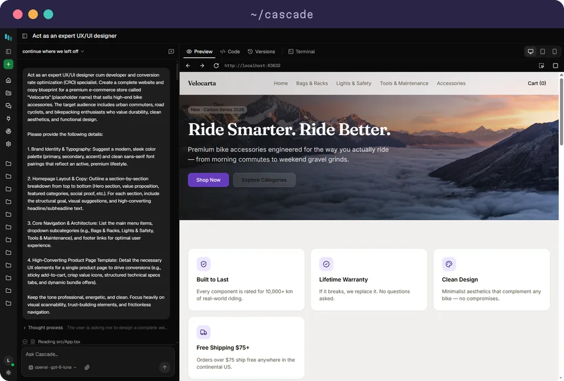
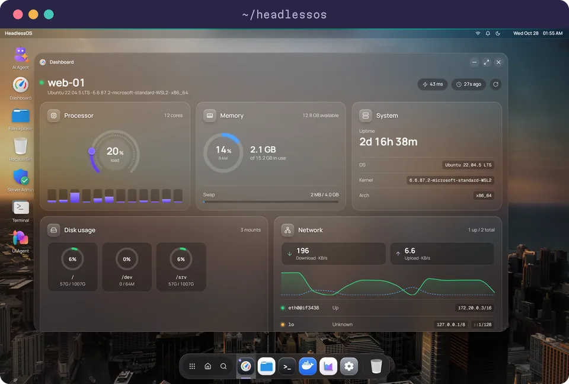
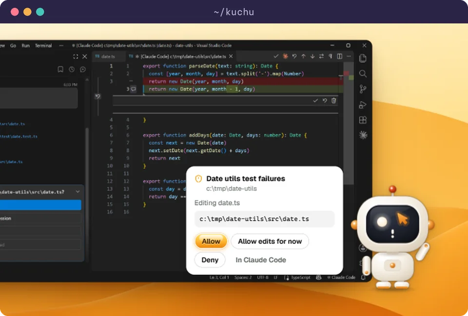
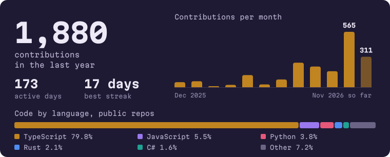

This year I've shipped an AI app builder that needs no cloud, a desktop for Linux servers that installs nothing on the server, and a desk pet that shows what Claude Code is doing. All three are open source under the MIT license.

           

## `~/projects`

<a href="https://appbuilder.sh"></a>

### [Cascade](https://github.com/abhee235/cascade-ai)

Build real apps from a prompt, right on your own machine. Describe what you want, and an agent writes the code, runs it in a sandboxed container and shows you a live preview. Use local Ollama models or bring your own key, in the desktop app or in VS Code.

<sub>Built with TypeScript, Electron, Docker, Ollama and MCP</sub>

[Website](https://appbuilder.sh) &nbsp; [Download](https://appbuilder.sh/#download) &nbsp; [Code](https://github.com/abhee235/cascade-ai)

<br clear="all">

<a href="https://headlessos.com"></a>

### [HeadlessOS](https://github.com/abhee235/headlessos)

A Windows-like desktop for headless Linux servers. Files, Docker, processes and a terminal, all over plain SSH with nothing installed on the server. Its AI agents pick from a fixed list of actions, and anything that changes the server waits for your approval.

<sub>Built with TypeScript, React, Fastify, Electron and SSH</sub>

[Website](https://headlessos.com) &nbsp; [Download](https://headlessos.com/download) &nbsp; [Code](https://github.com/abhee235/headlessos)

<br clear="all">

<a href="https://abhee235.github.io/kuchu/"></a>

### [Kuchu](https://github.com/abhee235/kuchu)

A desk pet for Claude Code. It thinks, works, waves when a session needs you and hops when one is done. Its card shows what's happening and lets you answer permission requests right there. On the Microsoft Store, with macOS in preview.

<sub>Built with Rust, Tauri and TypeScript</sub>

[Website](https://abhee235.github.io/kuchu/) &nbsp; [Microsoft Store](https://apps.microsoft.com/detail/9NNK1Q800R84) &nbsp; [Code](https://github.com/abhee235/kuchu)

<br clear="all">

**Also worth a look:** [neural-nets](https://github.com/abhee235/neural-nets), a build-it-yourself course on transformers and GPT-style models in TypeScript with no ML libraries, and [floorplan-ai](https://github.com/abhee235/floorplan-ai), which turns floor plans and briefs into editable 3D office models with a traceable bill of materials.

## `~/stats`



## `~/principles.ts`

```ts
const principles = {
  localFirst: "If it can run on your machine, it should. No account, no telemetry.",
  safeAgents: "Sandboxes, typed actions, approvals and audit logs, not just a model with a shell.",
  shipIt: "Installers, docs, websites and release pipelines are part of the work.",
};
```
